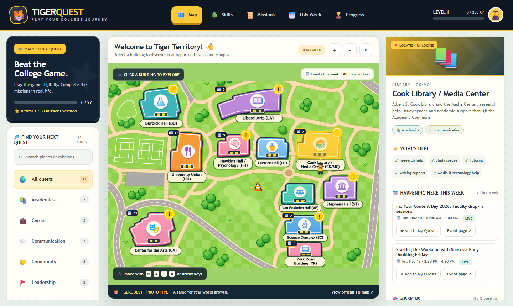
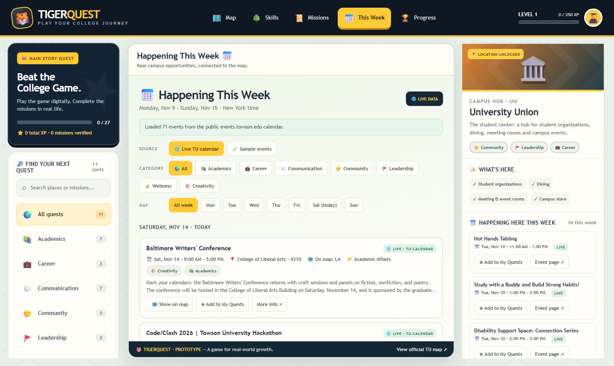
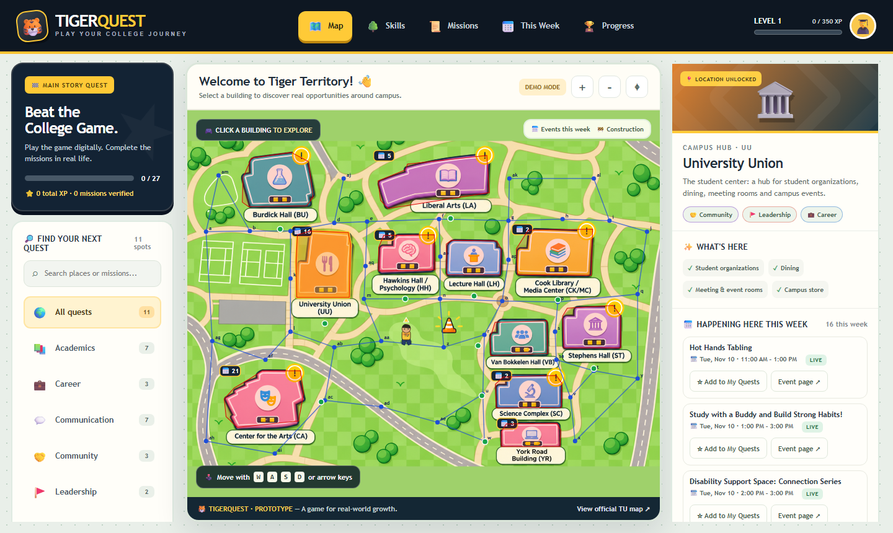

# 🐯 TigerQuest

**Play the game digitally. Complete the missions in real life.**

TigerQuest turns Towson University's campus into a game-style map. Students explore buildings, discover resources and this week's events, and earn XP for real-world activities like attending a workshop or joining a student organization.

*Built for **CODE/CLASH 2026** at Towson University · Track: Community & Social Impact*



---

## 📌 Project overview

### The problem
College campuses are full of opportunities: tutoring, career coaching, student organizations, workshops, performances and recreation. Many students never use them, not because the resources don't exist, but because students **don't know where to find them, don't know what's happening this week, or don't feel motivated to take the first step**. The information is spread across many websites, calendars and offices.

### Our solution
TigerQuest puts that information on one interactive, game-style campus map:

- **Explore** an illustrated Towson map and click buildings to see what resources live there.
- **Discover** real events happening this week, pulled from Towson's public events calendar, and see them on the map.
- **Commit** by saving events to "My Quests" and planning missions.
- **Grow** by earning XP in seven skill areas when real-world missions are completed.

TigerQuest does **not** simulate college life. The map helps students discover opportunities, and the actual participation happens in person.

---

## ✨ Key features (all implemented)

| Feature | What it does |
|---|---|
| 🗺️ **Interactive campus map** | Illustrated map with **11 clickable buildings** (BU, UU, CA, LA, HH, LH, CK/MC, ST, SC, YR, VB). Hover, click, tap, or use the keyboard (Tab, then Enter). |
| 🚶 **Character movement** | Click a building and your character walks along campus paths to it, using **Dijkstra's shortest-path algorithm** over a hand-made path network. You can also click an empty spot to walk there. |
| ⌨️ **Keyboard controls** | Smooth movement with **WASD or the arrow keys**, including diagonals. Buildings block movement, and pressing a key cancels automatic walking. |
| 🔍 **Zoom** | ＋ and － zoom in with a camera that follows the character. ⌖ resets the view. |
| 🏛️ **Building panel** | Description, services, skill categories, this week's events at the building, missions, and an official Towson link. |
| 🎯 **Missions** | 27 real-world missions with four states: **Available → Planned → Self-reported → Verified**. |
| ⭐ **XP, levels & skills** | XP from verified missions builds your level and **7 skill trees**: Academics, Career, Communication, Community, Leadership, Wellness, Creativity. |
| 📅 **Happening This Week** | This week's events (Monday–Sunday, New York time), with filters by category and day. Upcoming events are listed first. |
| 🌐 **Live Towson events** | Real events loaded from the public **events.towson.edu** calendar API, with automatic fallback to clearly labeled sample events. |
| 📍 **Event → map navigation** | "Show on map" highlights the event's building, walks the character there, and opens the event in the building panel. 📅 badges show how many events each building has. |
| 💾 **Saved events & progress** | "Add to My Quests" saves events. Missions, XP and saved events persist in the browser with `localStorage`. |
| 📱 **Responsive layout** | On desktop the map always stays centered and the sidebars scroll independently. Tablets get two columns. Phones get one column with a bottom-sheet details panel. |



---

## 🛠️ Technologies used

| Technology | Purpose in TigerQuest |
|---|---|
| **HTML5** | Page structure: top bar, sidebars, map area, screens (`index.html`) |
| **CSS3** (Grid, Flexbox, media queries) | Visual style, game-like layout, responsive design (`style.css`) |
| **Vanilla JavaScript** | All logic: map interaction, pathfinding, movement, missions, XP, events (`script.js`) |
| **SVG** | Map container, transparent clickable building outlines, the character sprite, event badges |
| **Fetch API + JSON** | Retrieves this week's public events from `events.towson.edu` |
| **`Intl.DateTimeFormat`** | Works out "this week" in the America/New_York time zone |
| **`requestAnimationFrame`** | Runs the game loop that animates the character (about 60 frames per second) |
| **`localStorage`** | Saves progress in the browser, with no database needed |

**Why so lightweight?** TigerQuest is a hackathon prototype that needed to be reliable, easy to demo and easy to understand. A static frontend has **no installation, no build step, no server and no database**. You open one file. Frameworks, game engines and backends would add setup and failure points without changing what the demo can show. See [docs/TECHNICAL_GUIDE.md](docs/TECHNICAL_GUIDE.md#why-we-built-tigerquest-this-way) for the tradeoffs.

No npm packages, no external libraries, no build tools.

---

## ▶️ How to run

1. **Download** this repository (green **Code** button → **Download ZIP**, then extract it) or clone it:
   ```bash
   git clone https://github.com/franklinbll/TigerQuest.git
   ```
2. Open the `TigerQuest` folder.
3. **Double-click `index.html`.**
4. It opens in your browser. **Google Chrome is recommended** (that's what we tested).

That's it. There is nothing to install.

**Internet connection:**
- *Online*: "Happening This Week" shows **live** Towson events.
- *Offline*: everything still works, and the app automatically shows **sample events** labeled "🧪 SAMPLE DATA".

**Browser notes:** tested in Google Chrome on Windows, both opened directly from the file (`file://`) and through a local web server. Microsoft Edge (also Chromium-based) is expected to behave the same but was **not separately tested**. Firefox and Safari were **not tested**.

---

## 🎮 How to use TigerQuest

1. **Explore the map.** Click any building (or tap it on a phone). Your character walks there and the right panel shows its resources, events and missions.
2. **Move around.** Use **WASD / arrow keys**, click empty ground, or zoom with ＋ / －.
3. **Filter.** Use the left sidebar to pick a skill category (non-matching buildings fade) or search by name.
4. **See what's happening.** Open **📅 This Week** and filter by category or day. Click **🗺️ Show on map** to travel to the event's building.
5. **Plan.** Click **☆ Add to My Quests** on events, or **📌 Plan it** on missions. Planning gives **no XP**.
6. **Complete missions in real life.** After doing the activity, a student would report it (**✋ I did this**). In this prototype, **⚡ Simulate verified completion** stands in for real verification and awards XP.
7. **Track growth** in **🌳 Skills**, **📜 Missions** and **🏆 Progress**. Progress is where you'll find saved events and the reset button.

> Tip for presenters: add `#debug` to the end of the URL (e.g. `index.html#debug`) to show the walking-path network and building outlines used by the pathfinding.



---

## 🌐 Event data: live vs. sample

| | Live data | Sample data |
|---|---|---|
| **Source** | Towson's public events calendar, `events.towson.edu`, through its public Localist API: `https://events.towson.edu/api/2/events?start=…&end=…` | Hard-coded templates in `script.js` (`SAMPLE_EVENT_TEMPLATES`) |
| **When used** | Automatically on startup, if the request succeeds | When the live request fails (offline, blocked, timeout), or if the user switches to "Sample events" |
| **Label** | 🌐 LIVE · TU CALENDAR | 🧪 SAMPLE DATA. These are invented examples, **not real Towson events** |
| **Dates** | Real event dates | Generated for the current week so the demo never goes out of date |

- The request is made **from the browser** with `fetch()`. No login or API key is needed, and the calendar allows browser requests from any website (CORS `Access-Control-Allow-Origin: *`).
- Event locations are matched to map buildings with simple text rules (e.g. "University Union" or "UU 222" → UU). Events at places not on our map are still listed, marked "Not on the TigerQuest map".
- **Involved@TU is not integrated.** We investigated it: its public RSS feed only covers about the next 24 hours, and its JSON endpoint is undocumented and blocked for browsers. See [docs/PROJECT_LIMITATIONS.md](docs/PROJECT_LIMITATIONS.md).

---

## ⚠️ Limitations (summary)

- **Mission verification is simulated.** No real attendance check exists yet.
- **Progress lives in one browser.** No accounts, no syncing between devices, and clearing browser data erases it.
- **Live events depend on an external calendar.** If it's unavailable, sample data is shown.
- **11 buildings only.** Building descriptions are intentionally general.
- **Location matching and categories are keyword-based** and can be imperfect.

Full details: **[docs/PROJECT_LIMITATIONS.md](docs/PROJECT_LIMITATIONS.md)**

## 🚀 Future improvements (not yet built)

- Real verification (e.g. event check-in QR codes or organizer confirmation)
- Student accounts and cloud-synced progress (requires a backend)
- An official integration with Involved@TU (would require university authorization)
- More buildings, real building hours, accessibility routes
- Notifications and reminders for saved events
- Usability testing with Towson students to measure whether gamification actually increases participation

---

## 🤖 AI-assisted development

Our team defined the problem, product concept, requirements, user experience decisions and priorities. **AI coding tools (including Claude by Anthropic) were used extensively to implement the code, debug it, research the event data sources, test it and write documentation.** The campus map illustration was also generated with an AI image tool (ChatGPT image generation), guided by the team's revisions to the campus layout. We reviewed the results, made product decisions based on them, and worked to understand how every part works (see the [Technical Guide](docs/TECHNICAL_GUIDE.md)). We don't claim to have hand-written the code that AI generated.

---

## 👥 Team

## 👥 Team

- Brian Addo
- Adanna Enyaosa
- Jephthe Fabre
- Franklin Bolanos

---

## 🏆 Hackathon

Created for **CODE/CLASH 2026 at Towson University**, Community & Social Impact track.
Prompt: *"How can technology break down barriers to personal growth, professional opportunity, and educational advancement?"*

---

## 📁 Repository structure

```text
TigerQuest/
├── index.html                    # Page structure
├── style.css                     # Styling and responsive layout
├── script.js                     # All application logic and data
├── assets/
│   └── towson-campus-map.png     # Illustrated campus map (1511 × 1041 px)
├── docs/
│   ├── TECHNICAL_GUIDE.md        # How TigerQuest works, explained for beginners
│   ├── JUDGE_CHEAT_SHEET.md      # Presentation script and Q&A preparation
│   ├── PROJECT_LIMITATIONS.md    # Limitations, simulated features, future work
│   └── screenshots/              # Screenshots used in this README
├── .gitignore
└── README.md
```

---

## 📄 License & attribution

**No license has been chosen yet.** Without a license, default copyright applies and others may not reuse the code. The team needs to choose a license (for example MIT) separately.

- TigerQuest is a student project and is **not affiliated with or endorsed by Towson University**. "Towson University" and building names are used only to describe real campus locations.
- Live event information belongs to its publishers on `events.towson.edu`. It is fetched at runtime and is not stored in this repository.
- Icons are standard Unicode emoji drawn by the viewer's operating system. No icon files are included.
- The campus map illustration (`assets/towson-campus-map.png`) was created by the team with an **AI image generator**. The file's embedded content credentials (C2PA) identify **ChatGPT / OpenAI image generation**, created Nov 14, 2026. 
